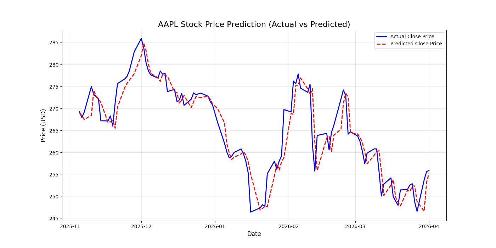

# Task 2: Short-Term Stock Price Prediction

## Objective
The objective of this task is to use historical stock market data to predict the next day's closing price. This project demonstrates time series data handling, regression modeling, and financial data fetching using the `yfinance` library.

## Dataset
Historical stock data for **Apple Inc. (AAPL)** was retrieved from Yahoo Finance for a 2-year period.

### Methodology
1. **Data Acquisition:** Fetched daily stock data (Open, High, Low, Close, Volume).
2. **Preprocessing:**
 * Created a target variable `Next_Close` by shifting the daily `Close` price by -1.
 * Data was split chronologically: 80% for training and 20% for testing.
3. **Modeling:**
 * A **Linear Regression** model was trained using the `scikit-learn` library.
 * **Features:** `Open`, `High`, `Low`, `Close`, `Volume`.
 * **Target:** `Next_Close`.

## Results and Evaluation
The model's performance was evaluated on the testing set:

- **Mean Absolute Error (MAE):** $2.46 (On average, the predicted price is within $2.46 of the actual price).
- **R-squared (R²) Score:** 0.8758 (The model explains approximately 87.58% of the variance in the stock prices).

### Visualization
The following plot compares the actual vs. predicted closing prices for the test period:


## Repository Structure
- `stock_prediction.py`: The main Python script.
- `plots/`: Directory containing the generated output plots.
- `README.md`: This file, documenting the project.

## How to Run
1. Install dependencies:
 ```bash
 pip install yfinance scikit-learn matplotlib pandas
 ```
2. Run the prediction script:
 ```bash
 python stock_prediction.py
 ```

---
*Created by Muhammad Awais*
